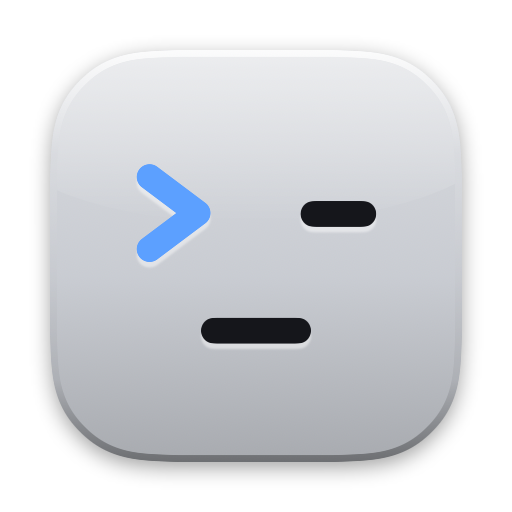
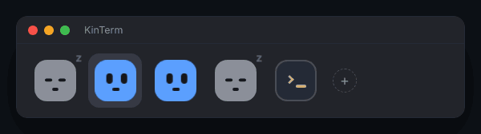

<div align="center">



# KinTerm

**The terminal for AI coding agents**<br>
Every tab is a face that shows what its agent is doing, so you know who's working,
who's done and who needs you, without opening a single tab.

[](https://github.com/lakpriya1s/kinterm/releases/latest)
[](https://github.com/lakpriya1s/kinterm/releases)
[](LICENSE)
[](#install)
[](#claude-code)
[](#credits)

[Website](https://lakpriya.com/kinterm/) · [Download](https://github.com/lakpriya1s/kinterm/releases/latest) · [Features](#features) · [Claude Code](#claude-code) · [Any agent](#any-agent-osc-7501) · [Build](#build-from-source) · [Credits](#credits)

</div>

---

<p align="center">
  
</p>

You run Claude Code in one tab, then another, then five. One is waiting for a yes,
one finished ten minutes ago, one hit a rate limit, and the only way to find out is to
click through every tab.

**KinTerm turns each tab into a face.** Gray and asleep when idle, blue with darting
eyes while it works, amber and surprised when it needs you, green and happy when it's
done, red with X eyes when something breaks. One glance at the tab bar tells you where
to go next. When you're in another app, a notification, the dock icon and the menu bar
tell you instead.

It's a full, fast, native macOS terminal underneath: KinTerm is built on
[Ghostty](https://ghostty.org), so you keep GPU rendering, native tabs and splits, and
your Ghostty config and themes.

## The faces

| Face | State | When | What you see |
| :--: | --- | --- | --- |
|  | **Idle** | The session has started and is ready for a prompt | Gray, eyes shut, a drifting "z" |
|  | **Working** | You sent a prompt; it's reading, editing, running tools | Blue, eyes looking left and right |
|  | **Waiting on you** | It asks for permission or a question | Amber, surprised, bouncing, "?" |
|  | **Done** | It finished its turn | Green, happy, a white dot until you look |
|  | **Error** | The turn ended on an API error: rate limited, overloaded | Red, X eyes, a little shake |

A tab with splits shows its most urgent agent: waiting, then error, done, working, idle.

## Features

| | |
| --- | --- |
| 🙂 | **A face on every tab.** The tab bar goes at the top, in the title bar, at the bottom, left or right, in S, M or L |
| 🎭 | **Six face sets.** Faces (the default), Square faces, Orbs, Shapes, Bots and Spark, all with the same five states |
| 🔎 | **Hover card.** Hover a face for the agent's last message, how much of its context is used, the git branch and the account |
| 🔔 | **Notifications** when an agent finishes, needs you or fails while you're somewhere else |
| 🚦 | **The app icon is a status light.** The dock icon takes the colour and expression of the agent that needs you most, with a badge for how many are waiting |
| 📊 | **Menu bar summary.** A live count of your agents from anywhere, in Compact, Full or Icon only style |
| 🧭 | **Agents panel.** <kbd>⌘</kbd><kbd>⇧</kbd><kbd>A</kbd> lists every agent in every window, most urgent first. <kbd>⌘</kbd><kbd>J</kbd> jumps straight to the next one waiting on you |
| 👥 | **Several Claude accounts.** Each account gets a colour, as a tint or a ring on its tabs. The `+` menu and <kbd>⌥</kbd><kbd>⌘</kbd><kbd>1</kbd>–<kbd>9</kbd> open a Claude Code tab with a given account, optionally in a new git worktree |
| 🧩 | **Subagents.** A small badge counts the subagents a session is running |
| 🪄 | **Setup Assistant.** On first launch, pick your faces, size and tab bar by looking at them, and it installs the Claude Code hook for you |
| 📡 | **An open protocol.** Any agent or script can report its state with [OSC 7501](#any-agent-osc-7501) |
| 🔄 | **Updates itself.** New versions arrive in the app, no reinstalling |

## Install

1. Download **KinTerm.dmg** from the [latest release](https://github.com/lakpriya1s/kinterm/releases/latest).
2. Open it and drag **KinTerm** to Applications.
3. Open KinTerm. The **Setup Assistant** walks you through the faces, the tab bar and
   the Claude Code hook. You can open it again any time from **KinTerm › Setup Assistant…**

Requirements: macOS 13 Ventura or later, on Apple silicon or Intel. KinTerm checks for
updates on its own, or use **KinTerm › Check for Updates…**

## Claude Code

The faces come from a small [Claude Code hook](agents/claude-code) that tells KinTerm
what each session is doing. The Setup Assistant installs it. To install it yourself
from a clone of this repo:

```sh
agents/claude-code/install.sh          # ~/.claude, or $CLAUDE_CONFIG_DIR
agents/claude-code/install.sh --all    # every ~/.claude* folder, one per account
```

It backs up each `settings.json` first, then adds the hook. Restart running Claude Code
sessions to pick it up. Remove it with `install.sh --uninstall`.

| Claude Code event | Face |
| --- | --- |
| `SessionStart` | Idle |
| `UserPromptSubmit`, `PreToolUse`, `PostToolUse` | Working |
| `Notification` | Waiting on you |
| `Stop` | Done |
| `StopFailure` | Error |

## Any agent: OSC 7501

KinTerm listens for [OSC 7501](https://www.superlogical.com/rex/docs/build/program-status),
the Program Status Protocol. Anything that runs in a tab can set its face by printing one
escape sequence:

```sh
printf '\e]7501;state=working:app=my-agent\e\\'   # blue, working
printf '\e]7501;state=blocked:app=my-agent\e\\'   # amber, waiting on you
printf '\e]7501;state=done:app=my-agent\e\\'      # green, done
```

`state` is one of `idle`, `working`, `blocked`, `done`, `error` or `clear`. Add
`msg=<base64 text>` to show a message in the hover card and the notification. See
[agents/claude-code](agents/claude-code/README.md) for every field the Claude Code hook
sends.

## Configuration

KinTerm reads `~/.config/kinterm/config.kinterm`, or on macOS
`~/Library/Application Support/com.kinterm.app/config.kinterm`. Until you create one, it
uses your Ghostty config if you have one. Themes go in `~/.config/kinterm/themes`, and
every [Ghostty option](https://ghostty.org/docs/config) works.

The faces, the tab bar, notifications and the menu bar summary are in the **View** menu
and the Setup Assistant. The `kinterm` command line tool is in
`KinTerm.app/Contents/MacOS`; run `kinterm +help` for its actions.

## Build from source

You need [Zig](https://ziglang.org) and Xcode.

```sh
git clone https://github.com/lakpriya1s/kinterm.git && cd kinterm
zig build -Demit-macos-app=false                      # the core library
cd macos && xcodebuild -target Ghostty -configuration Debug
open build/Debug/KinTerm.app
```

Or `scripts/dev-run.sh` to build and restart in one step.
[scope/HANDOFF.md](scope/HANDOFF.md) explains how the agent tabs fit into the codebase,
and [HACKING.md](HACKING.md) covers the Ghostty core.

## FAQ

**Is this Ghostty?** KinTerm is a fork of Ghostty with agent faces on top. The terminal
itself (emulation, rendering, fonts, config) is Ghostty's, and KinTerm keeps up with
Ghostty's changes.

**Will my Ghostty config work?** Yes. KinTerm uses it until you create a KinTerm config.

**Does it only work with Claude Code?** Claude Code works out of the box. Any other agent
or script can show a face with [OSC 7501](#any-agent-osc-7501).

**Linux?** Not yet. KinTerm is macOS only for now.

**Is it free?** Yes, free and open source under the MIT license.

## Contributing

Issues and pull requests are welcome. Please read [CONTRIBUTING.md](CONTRIBUTING.md)
first. For security issues, see [SECURITY.md](SECURITY.md).

If KinTerm saves you some tab-hunting, a ⭐ helps other people find it.

## Credits

KinTerm is built on **[Ghostty](https://github.com/ghostty-org/ghostty)** by
[Mitchell Hashimoto](https://github.com/mitchellh) and the Ghostty contributors. Almost
everything that makes it a great terminal comes from their work: thank you. KinTerm is an
independent project and isn't affiliated with or endorsed by Ghostty.

Updates are delivered with [Sparkle](https://sparkle-project.org). The status protocol is
[OSC 7501](https://www.superlogical.com/rex/docs/build/program-status).

## License

[MIT](LICENSE), the same as Ghostty.
