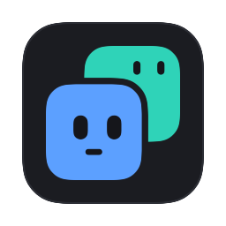
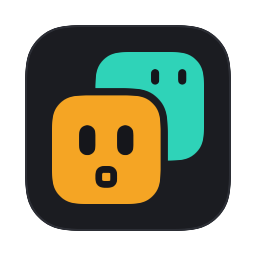
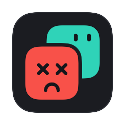

<p align="center">
  <picture>
    <source media="(prefers-color-scheme: dark)" srcset="images/kinterm/logo-dark.png">
    
  </picture>
</p>

<p align="center"><strong>Your agents, at a glance.</strong></p>

## About

KinTerm is a native macOS terminal for people who run coding agents. Every
tab is a face that shows what the agent inside it is doing, so you never lose
track of one that is working, finished, or waiting on you.

Your agents are kin, living in your terminal. The mark is two of them: the
one in front has a small smile, the one behind is a sibling agent peeking
over its shoulder.

| State          | Face                                |
| -------------- | ----------------------------------- |
| Idle           | Gray, eyes closed, "z"              |
| Working        | Blue, eyes moving, spinner ring     |
| Waiting on you | Amber, surprised, bouncing, "?"     |
| Done (unread)  | Green, happy, white dot until seen  |
| Error          | Red, X eyes                         |

- **Faces, not text.** Hover a face for the agent's last message, context
  used and branch.
- **The app icon is a status light.** Its front face takes the color of the
  agent that needs you most.
- **Notifications** when an agent finishes or needs you while you're
  somewhere else, plus a dock badge and a menu bar summary.
- **Several Claude accounts**, each with its own color.
- **An open protocol** (OSC 7501), so any agent can report its state.

<p align="center">
  
  
  
  
</p>

## Claude Code

Install the status hook into your Claude config folders:

```sh
agents/claude-code/install.sh --all
```

See [agents/claude-code](agents/claude-code/README.md) for details.

## Configuration

KinTerm reads `~/.config/kinterm/config.kinterm`, or on macOS
`~/Library/Application Support/com.kinterm.app/config.kinterm`. Until you
create one, it uses your Ghostty config if you have one. Themes go in
`~/.config/kinterm/themes`.

The `kinterm` command is in `KinTerm.app/Contents/MacOS`. Run
`kinterm +help` for its actions.

## Building

```sh
zig build -Demit-macos-app=false                       # the core library
cd macos && xcodebuild -target Ghostty -configuration Debug
open macos/build/Debug/KinTerm.app
```

Or `scripts/dev-run.sh` to build and restart in one step. See
[scope/HANDOFF.md](scope/HANDOFF.md) for the details and gotchas.
